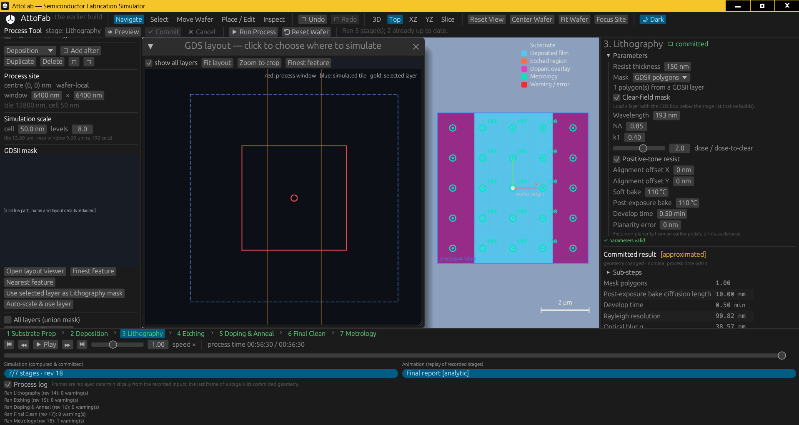
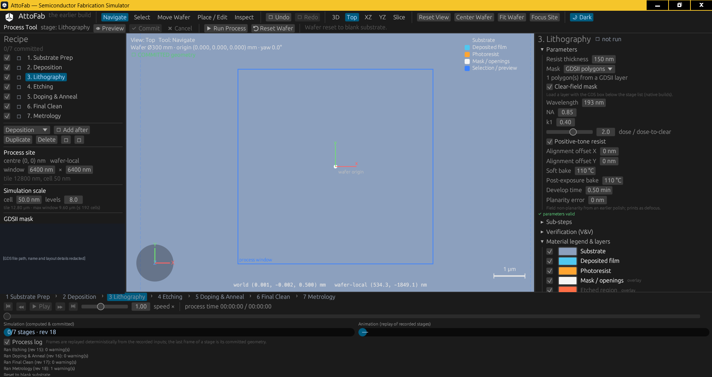

# AttoFab

AttoFab is a Rust program. It simulates semiconductor fabrication processes.

AttoFab keeps the wafer shape in a Sparse Voxel Octree (SVO). The SVO is the only main store of the wafer shape. The desktop program uses `eframe`, `egui` and `wgpu`. The web program uses the same user interface code.

> **WARNING**
> The physics models in this repository are a research base. They are not calibrated. Do not use the results to predict a real process. First calibrate the models and validate them against independent data.

## Screenshots

These images show the desktop program at the lithography stage. File paths and layout details are removed from the images.



*The lithography stage uses a GDSII polygon as the mask. Use the picker (left) to select where to simulate. The red box is the process window. The blue box is the simulated tile. The right panel shows the stage parameters and the results. The bake diffusion length is 10 nm. The Rayleigh resolution is 90.8 nm.*



*Reset Wafer gives a blank substrate. The recipe stays. No stage is committed (0 of 7). You can run the recipe again.*

## Parts of the program

- `sim_core/` holds the SVO wafer state, the process stage models, the GDSII input, the dependency graph and the GPU export tools. It does not use a dense `Wafer2d` or `Wafer3d` array as the main wafer state.
- `sim_ui/` holds the shared `egui` application and the view models.
- `app_desktop/` is the native desktop shell for Windows and Linux. It links to the Rust core directly. It does not use a web view or a local HTTP server.
- `app_web/` is the browser shell. It uses the same user interface and the same SVO core. It uses the `eframe` GL renderer, which works in more browsers. The desktop program uses `wgpu`.
- `app_android/` is source code only. The workspace does not build it.

The SVO keeps uniform regions small. It divides the SVO only where a process feature needs more detail. This does not mean that a 1 nm cell over a full 300 mm wafer is possible. For each simulation, you must set the resolution, the local refinement and the node budget.

## Prerequisites

- The Rust stable toolchain and Cargo.
- For the web build only: the `wasm32-unknown-unknown` target and `wasm-pack`.
- For the fast desktop renderer: a GPU and a driver that `wgpu` supports. If the GPU is not supported, `eframe` uses a fallback. The fallback depends on your platform and driver.

## Build and run on Windows

1. Open PowerShell in this directory.
2. Run the tests:

   ```powershell
   cargo test --workspace
   ```

3. Start the desktop program:

   ```powershell
   cargo run -p app_desktop
   ```

You can also double-click `run_desktop.bat`.

The first build downloads the Rust crates from crates.io. If PowerShell cannot find Cargo, install Rust from https://rustup.rs. Then close the terminal and open it again.

> **NOTE**
> The test `gpu_render` in `sim_ui` needs a display and a GL context. It does not run on a computer without them.

## Build the web version

1. Add the WASM target and install `wasm-pack`:

   ```powershell
   rustup target add wasm32-unknown-unknown
   cargo install wasm-pack
   ```

2. Build the package:

   ```powershell
   wasm-pack build app_web --target web --out-dir pkg
   ```

3. Start a local web server:

   ```powershell
   python -m http.server 8080 --directory app_web
   ```

4. Open `http://localhost:8080` in a browser.

You can also run `build_web.bat`. It installs the WASM target and `wasm-pack` if they are missing. Then it builds the package.

The build creates the `pkg` output on your computer. The repository does not contain it.

## Verification status

The workspace was built and tested on Linux. The command `cargo build --workspace` completes. The command `cargo test --workspace` gives 1011 passed tests and 0 failed tests. The `gpu_render` test did not run, because the test computer has no GL context.

Some checks are not complete. See the section Release history for the open items.

## Validation priorities

1. SVO divide and merge rules, region clipping, save and load round trips, and leaf budget limits.
2. Implant dose conservation and units. The units are: dose in ions/cm², depth in nm, concentration in ions/cm³.
3. Diffusion that depends on the material, and the interface boundary conditions.
4. Oxidation coupling: silicon use, oxide expansion and surface movement.
5. Implant ranges and process parameters compared with SRIM/TRIM or measured data.
6. Desktop and WASM builds on the real target computers.

## Known limits

- The shared user interface shows a schematic cross-section, process stage switches and local SVO material edits. It is not a validated 3D renderer.
- Most physics stages use closed-form or phenomenological models. Some stages do not change the SVO shape directly. The calibration is not complete.
- The recipe has seven stages by default. CMP is an optional eighth stage.

## 3D viewport

The native viewport has these controls:

- Orbit in 3D.
- Pan with the middle mouse button.
- Zoom with the mouse wheel.
- Select the view: TOP, X-Z, Y-Z or Slice.
- Reset the camera.
- Select an SVO leaf.

A click on the SVO selects a leaf. The viewport shows the material and the bounds of the leaf. It does not make a dense grid. 

## Process simulation core

The module `sim_core::pipeline` runs the enabled stages in recipe order. It makes local material edits on a copy of the SVO wafer. The edits are deterministic. For each stage it records the node count and notes. It also stores snapshots, so that you can go back.

These shape operators are reference models. They are not calibrated industrial TCAD.

## Calibration data

The directory `data/calibration/` has no verified experimental data. Do not use the synthetic blind-test demo as calibration or validation evidence. Add only data that you can trace to a source. For each data set, record the source, the units, the conditions, the uncertainty, the license and the train, calibration and test split.

## Release history

### Step 82: the workspace builds and its tests pass

- Develop: a new recipe uses a develop time of 0.5 min. At 1.0 min a 150 nm line printed at 96 nm. A column that is developed to within 1 % of the film is now open.
- Bake: the post-exposure-bake diffusion constant was about 100 times too small. It is now correct.
- Etch: the loading factor now uses the open fraction of the whole window. The default etch time is 2.5 min.
- Stages: a new recipe has the seven original stages. CMP is an optional eighth stage.
- Verification: the resist CD check compares with a reference that includes the bake and the developer. Its tolerance is 1.5 cells.

Open items:

- The conservation check `CONS-ETCH` compares with an unscaled etch.
- Two programs have the name `attofab`: `atto_cli` and `app_desktop`.
- The `gpu_render` test did not run, because it needs a GL context.
- The FullStack PRD has not been checked requirement by requirement.
- Many planned features are not built.

## License

Copyright (C) 2026 Lokesh Gundoju (GitHub: LKSH-GNDJ)

AttoFab is free software. You can redistribute it and you can change it under the terms of the GNU General Public License, version 3 or (at your choice) any later version. The file `LICENSE` has the full text.

AttoFab has no warranty. This includes the implied warranty of merchantability and the implied warranty of fitness for a particular purpose. See the GNU General Public License for details.

If you share a changed version, you must:

- Keep this copyright notice and the `LICENSE` file.
- Say that you changed the code.
- Give the source code of your version under the same license.

Third-party code:

- A release links about 340 third-party crates from `Cargo.lock`. Each crate has its own license. This repository does not list them. To list them, run `cargo install cargo-license` and then `cargo license`.
- A separate MIT-licensed dense-grid AttoFab code base exists. This repository does not include it. Read both licenses before you combine the two code bases.
